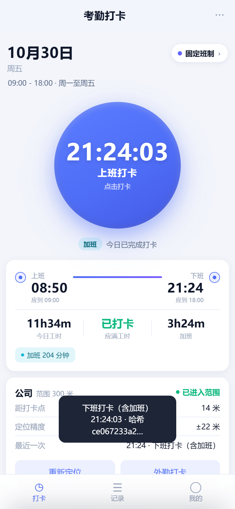
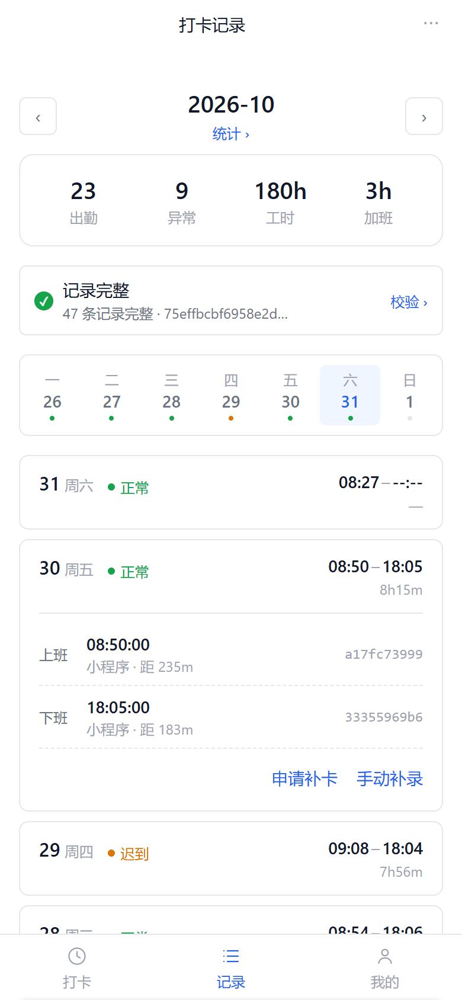
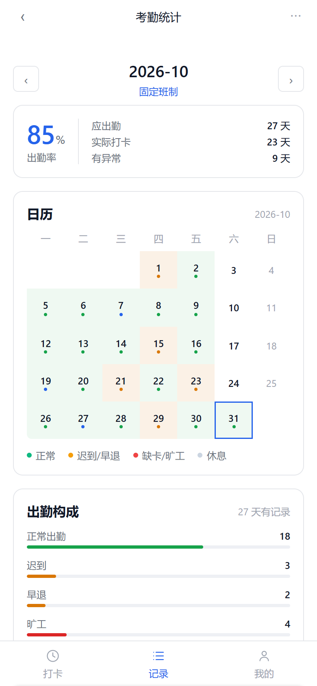

# 打卡小程序（punch-clock）v2

对齐钉钉考勤模型的打卡应用。**四种考勤规则随时可选**：固定班制 / 弹性工作制 / 排班制 / 自由工时。
不统计薪酬（只看出勤与工时）。

三重形态，同一套判定逻辑：

| 形态 | 打开方式 | 适合 |
|---|---|---|
| **手机网页版**（已上线） | <https://jimgreen1565-droid.github.io/punch-clock/> | 立刻试用，不用装任何东西 |
| **微信小程序** | 开发者工具导入本仓库根目录 | 做成微信小程序 |
| 桌面预览 | <https://jimgreen1565-droid.github.io/punch-clock/demo/> | 三栏看全貌 |

## 立刻试

手机浏览器（微信内也能开）打开：

### **<https://jimgreen1565-droid.github.io/punch-clock/>**

- 首次打开自动灌入一个月示例数据，可直接点打卡 / 换规则 / 看统计
- 允许定位后会取你当前位置与「打卡点」比较。**默认打卡点在北京市中心**，
  进去第一件事：点右上角规则胶囊 → 「打卡点坐标」→ 改成你自己的位置
- iPhone Safari「分享 → 添加到主屏幕」，Android Chrome「菜单 → 添加到主屏幕」，
  加完就是全屏 App 体验

> Web 版数据存在浏览器 localStorage，**不上传任何服务器**。换设备数据不会跟过去——这是单机版的取舍。



## 四种规则

| 规则 | 判定什么 | 什么时候选 |
|---|---|---|
| **固定班制** | 迟到、早退、缺卡、旷工都按分钟判定；班次窗口外的下班算加班 | 写字楼、行政、客服白班 |
| **弹性工作制** | 只卡「最晚上班时间」+「每日应满工时」，下班时间随到岗时间自动顺延 | 研发、设计 |
| **排班制** | 按排班表取当天班次；支持多班次周期轮换（三班倒） | 门店、工厂、医院 |
| **自由工时** | 不判迟到早退旷工，只累计工时对标目标 | 外勤、家政、装修、物流 |

切换规则后**今天的判定按新规则重算，已产生的打卡记录不会被改写**（哈希不变）。

| 考勤规则 | 打卡记录 | 考勤统计 |
|---|---|---|
|  |  |  |

## 除「能打卡」还做了什么

| 能力 | 说明 | 文件 |
|---|---|---|
| **规则可选** | 四种类型随时切换 + 规则模板保存/应用 | `core/rules.js`、`pages/rules` |
| **服务端授时** | `at` 一律用云函数时钟；客户端时间存 `clientAt` 对比，差 >90 秒标 `timeSkew` | `cloudfunctions/punch` |
| **精度参与围栏判定** | 不只看点在不在圈内，还要求 `dist-acc ≤ radius` **且** `acc ≤ radius`。±600 米定位落在公司正中心也拒绝 | `utils/geo.js` |
| **哈希链防篡改** | 每条带 `prevHash`/`hash`，任何字段改动都能定位到第几条 | `core/ledger.js` |
| **跨天班次** | 夜班 21:00-06:00，凌晨 3 点的下班卡自动归前一天；用「强匹配优先」避免误归 | `core/rules.js: resolveShiftDay` |
| **弹性班应下班滑动** | `max(最早下班, 实际上班 + 应满工时 + 午休)` | `core/rules.js: pairDay` |
| **午休扣除** | 在岗 8h ≠ 工时 8h | 同上 |
| **打满后不误写** | 上下班齐了按钮变「已完成」，再点弹确认，只有明确「补一条」才写入 | `utils/punch.js`、`pages/index` |
| **定位失败不阻断** | 拿不到定位仍可打卡，标「未定位待审核」并要备注 | `utils/punch.js` |
| **外勤打卡** | 范围外 + 必填原因 → 标记待审核，不是悄悄放行 | 同上 |
| **补卡规则** | 是否允许 / 可补天数 / 每月次数，按飞书口径校验后才允许提交 | `core/rules.js: canApplyPatch` |
| **补卡审批** | 审批通过生成 `source=patch` 的新记录接入链尾，不改历史 | `cloudfunctions/admin` |
| **角色判权** | `admin`/`manager` 判定全在云函数里，前端改不了 | 同上 |

## 目录结构

```
punch-clock/
├── project.config.json
├── miniprogram/                      ← 微信小程序
│   ├── app.js / app.json / app.wxss  #   浅色 Aurora 主题
│   ├── core/                         # ★ 纯逻辑，无 wx API，两端共用
│   │   ├── rules.js                  #   四种规则、班次窗口、跨天归属、定级、日配对
│   │   ├── ledger.js                 #   哈希链
│   │   └── sha256.js                 #   纯 JS SHA-256（小程序没有 crypto.subtle）
│   ├── utils/                        #   store / cloud / geo / punch
│   ├── pages/{index,records,stats,me,rules,admin}/
│   └── assets/tabbar/*.png           #   Chrome 渲染 SVG 生成
├── webapp/                           ← 手机网页版（线上那份）
│   ├── index.html / app.css / app.js
│   └── core-bundle.js                #   由 scripts/build-preview.js 打包 core
├── cloudfunctions/                   # 云开发（可选）
│   ├── _shared/common.js             #   共享工具 + 服务端规则引擎
│   └── login/  punch/  admin/
├── demo/preview.html                 # 桌面三栏预览
├── scripts/
│   ├── lint-miniprogram.js           #   静态校验（无开发者工具也能查出真问题）
│   ├── build-preview.js              #   core → 浏览器 bundle（含 geo）
│   ├── sync-shared.js / make-icons.mjs
│   ├── shoot.js / shoot-web.js       #   真实 Chrome 截图
│   └── deploy 相关见 .github/workflows/deploy.yml
├── tests/                            # 111 个用例
└── docs/
```

## 测试

```bash
npm run check       # = 静态校验 + 全部测试（含真实浏览器跑 Web 版）
```

```
✔ 静态校验通过（21 个 js，6 个页面）

core.test.js                35 pass  规则引擎 / 补卡规则 / SHA-256 对拍
hash-consistency.test.js     7 pass  ★ 客户端与云端哈希必须逐字段一致
server-rules.test.js        13 pass  服务端独立复算 + 客户端-服务端交叉比对
rule-compare.test.js         8 pass  ★ 同一组打卡行为 × 四种规则 的判定差异
pages.test.js               27 pass  六个页面真跑（wx 模拟器）
cloud.test.js               11 pass  云函数（内存版 wx-server-sdk）
web.test.js                 10 pass  ★ 真实 Chrome + 真实定位跑网页版
```

两个 ★ 值得一提：

- **`rule-compare.test.js`**：同一份「09:10 上班、17:40 下班」，四种规则算出的迟到分钟数是
  `{fixed: 10, flexible: 0, shift: 70, free: 0}`。一眼能看出差异是否符合产品语义。
- **`web.test.js`**：Web 版没框架，弹层/按钮全手写，最容易出「点了没反应」的静默 bug。
  这个套件抓到了一个真 bug：`closeSheet()` 先把回调置空再调用，导致所有「确定」按钮全部失效
  （外勤打卡、规则切换、补卡、改时间全废）。现在有一条测试专门钉死它。

**静态校验**：没有开发者工具时，`scripts/lint-miniprogram.js` 能当半个编译器——
检查四件套齐备、PNG 头合法、WXML 标签闭合、`{{}}` 字段是否在 `Page.data`、
`bindtap` 回调是否真实存在。我故意注入两个 bug 验证过它确实会报错。

## 发布成微信小程序

见 [在线体验与发布.md](docs/在线体验与发布.md)，五步：
注册小程序账号 → 拿 AppID → 填进 `project.config.json` → 开发者工具上传 → 提交审核并发布。

两个审核前必做的事（文档里有细节）：
1. **用户隐私保护指引**勾选「位置信息」，否则审核必拒
2. 换成自己的公司坐标（团队用必须上云开发，否则每个人能设自己家）

## 文档

- [在线体验与发布.md](docs/在线体验与发布.md) — 在线地址、PWA 添加到桌面、小程序上架五步、审核卡点
- [考勤规则设计.md](docs/考勤规则设计.md) — 四种规则怎么判、为什么这么判、和钉钉的对应、已知不足
- [部署与接入.md](docs/部署与接入.md) — 云开发全流程、6 个集合索引、权限、7 类常见报错
- [设计说明.md](docs/设计说明.md) — 架构取舍（哈希链、双模式、时区、浅色 UI）
- [数据格式.md](docs/数据格式.md) — 字段字典 + 可被 Python 独立复现的哈希算法

## v3：视觉与规则再优化（2026-10-31）

按 `web-design-standards` + `frontend-design` 重做，并对照钉钉/飞书补规则。

**视觉**（详见 [设计计划.md](docs/设计计划.md)）：
- 删掉紫色渐变打卡按钮、`blur(40px)` 光晕、24px 大圆角、卡片投影、彩色 tag 底
- 改为：单一 `#2563EB` 实心圆按钮、12px 圆角 + 1px 边框、状态只做 6px 圆点
- 图标从 emoji 换成统一 1.5px 描边 SVG（`webapp/icons.js`）
- 删掉重复信息（同一时间在按钮和指标里各报一次）、休息日不再显示空时间轴
- 统计日历加极浅热力底，一眼看出"哪一周崩了"

**规则**（对齐飞书）：
- 新增补卡规则：是否允许 / 可补天数 / 每月上限，提交前校验（`canApplyPatch`）
- 出勤构成按"出勤结果"而非"主状态"归类（加班日算正常出勤，单列"其中 X 天有加班"）

**修掉的逻辑 bug**：
- 已上班后"今日工时"永远显示 0m（未随计时累加）→ 改为计时中
- 加班日被排除在"正常出勤"之外，构成各项加不到总数
- 工作日被改成"每天"时"应出勤"变成 31 天 → 截图脚本与统计口径修正

## v2 相对 v1 的变化

- **新增四种考勤规则**（v1 只有单一固定班次）+ 独立「考勤规则」页可随时切换、存模板
- **移除薪酬统计**（v1 有计薪模块），统计页只留出勤率 / 异常分布 / 工时 / 趋势
- **UI 重做**：深色改浅色（打卡一天开很多次，户外强光下浅色可读性好），卡片化 + 渐变主按钮
- **新增手机网页版**：可直接在线试，也能「添加到主屏幕」当 App 用
- 新增「弹性班应下班滑动」「工时不足 15 分钟容忍」「外勤打卡必填备注」「打满后不误写」等细节
- tabBar 从 4 项收敛成 3 项（统计并入「记录」页入口），减一层导航
