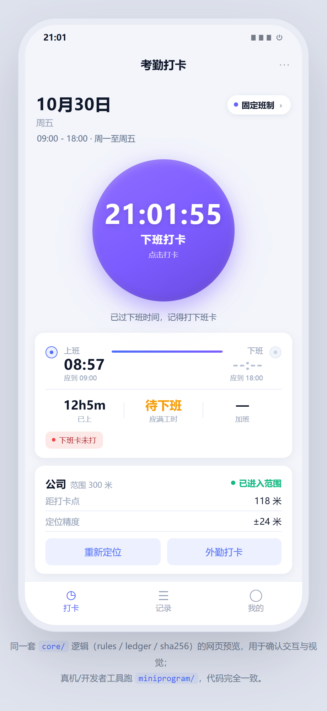
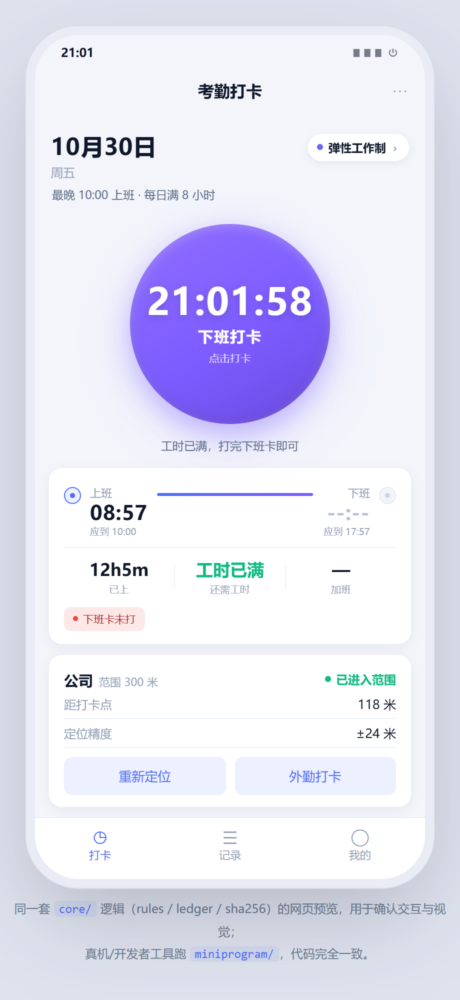
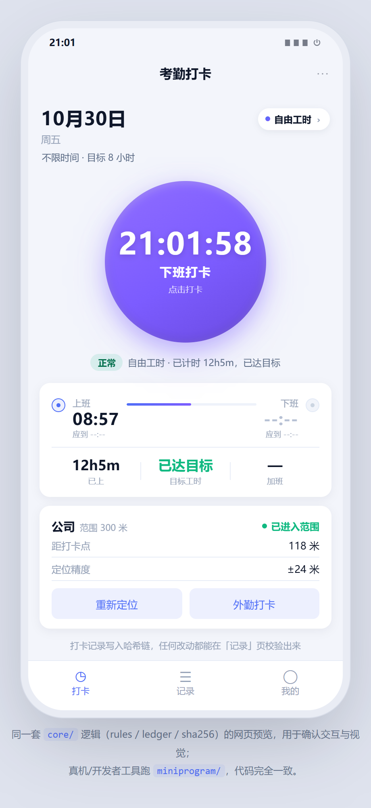
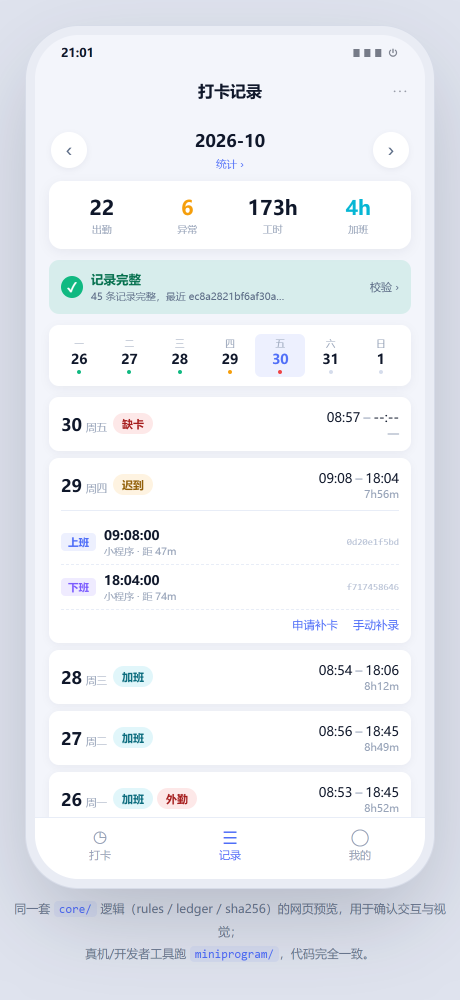
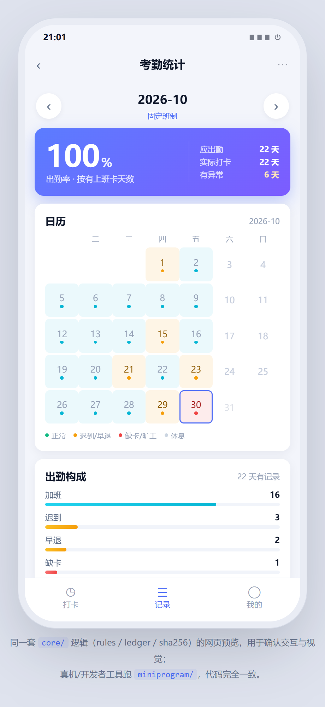

# 打卡小程序（punch-clock）v2

对齐钉钉考勤模型的打卡小程序。**四种考勤规则随时可选**：固定班制 / 弹性工作制 / 排班制 / 自由工时。
不统计薪酬（只统计出勤与工时）。

零依赖、纯原生（无框架、无第三方 SDK）。双击即可在开发者工具里跑，也能脱离云端离线演示。



## 一分钟跑起来

1. 打开**微信开发者工具** → 导入项目 → 选本仓库根目录（含 `project.config.json` 的那层）
2. AppID 填 `touristappid`（工具自带测试号）或你自己的
3. 直接编译 —— **不用装 npm 包、不用开云开发**，默认「本地离线模式」，全部功能可用
4. 想看效果又不想开工具：双击 `demo/preview.html`（网页版预览，同一套 `core/` 逻辑）

> 进去先点右上角「固定班制」胶囊 → 把打卡点设成你当前位置，否则会一直提示超出范围。

## 界面

| 打卡（固定班制） | 打卡（弹性） | 打卡（自由工时） |
|---|---|---|
|  |  |  |

| 考勤规则 | 打卡记录 | 考勤统计 | 我的 |
|---|---|---|---|
|  |  |  |  |

管理端（补卡审批 / 异常审核）见 `docs/shot-admin.png`。

## 四种规则

| 规则 | 判定什么 | 什么时候选 |
|---|---|---|
| **固定班制** | 迟到、早退、缺卡都按分钟判定；班级窗口外的下班算加班 | 写字楼、行政、客服白班 |
| **弹性工作制** | 只卡「最晚上班时间」+「每日应满工时」，下班时间随到岗时间自动顺延 | 研发、设计 |
| **排班制** | 按排班表取当天班次；支持多班次周期轮换（三班倒） | 门店、工厂、医院 |
| **自由工时** | 不判迟到早退旷工，只累计工时对标目标 | 外勤、家政、装修、物流 |

切换规则后**今天的判定按新规则重算，已产生的打卡记录不会被改写**（哈希不变）。

## 除「能打卡」还做了什么

| 能力 | 说明 | 文件 |
|---|---|---|
| **规则可选** | 四种规则类型随时切换 + 规则模板保存/应用 | `core/rules.js`、`pages/rules` |
| **服务端授时** | `at` 一律用云函数时钟；客户端时间存 `clientAt` 对比，差 >90 秒标 `timeSkew` | `cloudfunctions/punch` |
| **精度参与围栏判定** | 不只看点是否在圈内，还要求 `dist-acc ≤ radius` **且** `acc ≤ radius`。±600 米定位落在公司正中心也拒绝 | `utils/geo.js` |
| **哈希链防篡改** | 每条带 `prevHash`/`hash`，任何字段改动都能定位到第几条 | `core/ledger.js` |
| **跨天班次** | 夜班 21:00-06:00，凌晨 3 点的下班卡自动归前一天；用「强匹配优先」避免误归 | `core/rules.js: resolveShiftDay` |
| **弹性班应下班滑动** | `max(最早下班, 实际上班 + 应满工时 + 午休)` | `core/rules.js: pairDay` |
| **午休扣除** | 在岗 8h ≠ 工时 8h | 同上 |
| **定位失败不阻断** | 拿不到定位仍可打卡，标「未定位待审核」并要备注 | `utils/punch.js` |
| **外勤打卡** | 范围外 + 必填原因 → 标记待审核，不是悄悄放行 | 同上 |
| **补卡审批** | 审批通过生成 `source=patch` 的新记录接入链尾，不改历史 | `cloudfunctions/admin` |
| **角色判权** | `admin`/`manager` 判定全在云函数里，前端改不了 | 同上 |

## 目录结构

```
punch-clock/
├── project.config.json
├── miniprogram/
│   ├── app.js / app.json / app.wxss      # 浅色 Aurora 主题
│   ├── core/                            # ★ 纯逻辑，无 wx API，可被 Node 直接单测
│   │   ├── rules.js                     #   四种规则、班次窗口、跨天归属、定级、日配对
│   │   ├── ledger.js                    #   哈希链
│   │   └── sha256.js                    #   纯 JS SHA-256（小程序没有 crypto.subtle）
│   ├── utils/
│   │   ├── store.js                     #   本地存储（含规则集与模板）
│   │   ├── cloud.js                     #   云函数封装（离线兜底）
│   │   ├── geo.js                       #   Haversine + 精度门槛围栏
│   │   └── punch.js                     #   打卡编排（8 步流程）
│   ├── pages/{index,records,stats,me,rules,admin}/
│   └── assets/tabbar/*.png              # Chrome 渲染 SVG 生成
├── cloudfunctions/
│   ├── _shared/common.js                # 共享工具 + 服务端规则引擎
│   └── login/  punch/  admin/
├── demo/preview.html                    # 网页预览（同一套 core/）
├── scripts/
│   ├── lint-miniprogram.js              #   静态校验（无开发者工具也能查出真问题）
│   ├── build-preview.js / sync-shared.js
│   ├── make-icons.mjs                   #   SVG → PNG
│   └── shoot.js                         #   真实 Chrome 截图
├── tests/                               # 94 个用例，无任何测试框架依赖
└── docs/
```

## 测试

```bash
npm run check      # = 静态校验 + 全部测试
```

```
✔ 静态校验通过（21 个 js，6 个页面）

core.test.js                29 pass  规则引擎 / SHA-256 与 node crypto 对拍
hash-consistency.test.js     7 pass  ★ 客户端与云端哈希必须逐字段一致
server-rules.test.js        13 pass  服务端独立复算（含客户端-服务端交叉比对）
rule-compare.test.js         8 pass  ★ 同一组打卡行为 × 四种规则 的判定差异
pages.test.js               26 pass  六个页面真跑一遍（wx 模拟器）
cloud.test.js               11 pass  云函数（内存版 wx-server-sdk）
```

**静态校验**值得一提：没有微信开发者工具时，`scripts/lint-miniprogram.js` 能当半个编译器用——
检查四件套齐备、PNG 头合法、WXML 标签闭合、`{{}}` 字段是否在 `Page.data`、
`bindtap` 回调是否真实存在。我故意注入两个 bug 验证过它确实会报错。

## 接入云开发（可选）

默认不接也能用。想接见 [部署与接入.md](docs/部署与接入.md)：
环境 ID → 6 个集合 → 索引 → 权限 → 部署 3 个云函数 → 把自己设成 admin。

## 文档

- [考勤规则设计.md](docs/考勤规则设计.md) — 四种规则怎么判、为什么这么判、和钉钉的对应关系、已知不足
- [部署与接入.md](docs/部署与接入.md) — 云开发上线全流程、索引、权限、7 类常见报错
- [设计说明.md](docs/设计说明.md) — 架构取舍（哈希链、双模式、时区）
- [数据格式.md](docs/数据格式.md) — 字段字典 + 可被 Python 独立复现的哈希算法

## v2 相对 v1 的变化

- **新增四种考勤规则**（v1 只有单一固定班次），并新增独立「考勤规则」页可随时切换、可存模板
- **移除薪酬统计**（v1 有计薪模块），统计页只留出勤率 / 异常分布 / 工时 / 趋势
- **UI 重做**：深色改浅色（打卡类 App 一天开很多次，户外强光下浅色更可读），卡片化 + 渐变主按钮
- 新增「弹性班应下班滑动」「工时不足 15 分钟容忍」「外勤打卡必填备注」等判定细节
- tabBar 从 4 项收敛成 3 项（统计并入「记录」页入口），减一层导航
